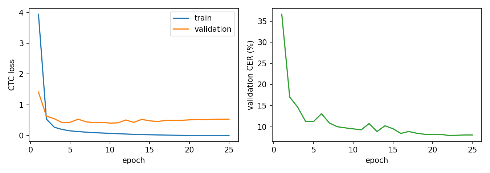

# 5. Model B: CRNN with CTC

*Owner: Nikhil. Architecture and setup are taken from the code (`src/crnn/`); results are from `results/crnn_full_greedy/`.*

## 5.1 Method

The CRNN of Shi et al. [1] reads a word image as a sequence. A convolutional network turns the image into a sequence of feature columns, a bidirectional LSTM lets every column use the context to its left and right, and a linear layer gives, for every column, a probability over the characters plus a special **blank** symbol. We train with the Connectionist Temporal Classification (CTC) loss [5], which needs no information about where each character is in the image: it sums over all alignments of the column sequence to the label.

At prediction time, **greedy decoding** takes the most likely symbol in every column, merges consecutive repeats and removes blanks. A blank between two equal symbols keeps both, for example `क क - म - - ल ल` gives `कमल`.

## 5.2 Architecture

| Stage | Layers | Output shape (height × width/4 columns) |
|---|---|---|
| Input | grayscale word image, height 64 | 1 × 64 × W |
| Conv block 1 | Conv 3×3 (64), BatchNorm, ReLU, MaxPool 2×2 | 64 × 32 × W/2 |
| Conv block 2 | Conv 3×3 (128), BatchNorm, ReLU, MaxPool 2×2 | 128 × 16 × W/4 |
| Conv block 3 | 2 × [Conv 3×3 (256), BatchNorm, ReLU], MaxPool 2×1 | 256 × 8 × W/4 |
| Conv block 4 | 2 × [Conv 3×3 (512), BatchNorm, ReLU], MaxPool 2×1 | 512 × 4 × W/4 |
| Sequence | reshape to T = W/4 columns of 2048 features, Linear to 256 | T × 256 |
| Recurrent | 2-layer bidirectional LSTM, 256 hidden units, dropout 0.3 | T × 512 |
| Output | Linear to (characters + blank), log-softmax | T × (C + 1) |

The network has about 7.7 million parameters (7,691,526 for a vocabulary of 70 characters; the exact count is in `metrics.json`). Because the width is divided by 4, an image of width 128 gives T = 32 time steps. CTC needs at least as many time steps as the label has characters plus one blank between equal neighbours, so we check that every label fits.

## 5.3 Training setup

| Setting | Value |
|---|---|
| Loss | CTC, blank = 0, computed in float32, `zero_infinity=True` |
| Optimiser | AdamW, learning rate 1e-3, weight decay 1e-4 |
| Schedule | One-cycle (15 % warm-up), gradient clipping at 5 |
| Batch size | 64 |
| Precision | mixed precision (fp16) on GPU |
| Model selection | lowest validation CER; early stopping after 8 epochs without improvement |
| Training | 25 epochs, 93 minutes on a Colab T4 GPU (about 3.7 minutes per epoch) |
| Augmentation | none |
| Seed | 42 |

Before the full run, the model was trained on 100 training images, with dropout switched off, to confirm the implementation. It reproduced all of them exactly (CER = 0) after 163 epochs (about 1,630 updates, 3.5 minutes on a GPU). A first attempt with only 750 updates and dropout on reached CER 0.50, so this check needs enough updates; the full run has about 1,000 updates per epoch.

## 5.4 Results

Test set (12,869 words, 3 writers not seen in training), evaluated once with the checkpoint of lowest validation CER (epoch 22 of 25).

| Metric | Value |
|---|---|
| CER | 6.59 % |
| WER (word error) | 26.05 % |
| Word accuracy | 73.95 % |
| Parameters | 7,707,429 |
| Training time to the best epoch (min) | 82.1 (93.3 for all 25 epochs) |
| Time per image (ms) | 3.56 |

*Figure: training and validation CTC loss (left) and validation CER (right) per epoch.*

## 5.5 Observations

1. **Fast start, early plateau.** Validation CER fell from 36.7 % after the first epoch to 11.3 % after four, then crept down to 7.94 % at the best epoch (22 of 25, the log counts from 0) and stayed there (7.98 % and 8.04 % in the last two epochs). Training loss kept falling (3.9 to 0.003) while validation loss stopped improving early (lowest 0.40 at epoch 10, 0.53 at the end), so the model fits its 7 training writers almost perfectly and the remaining error is generalisation to new handwriting.
2. **The writer matters more than the word.** Test CER is 3.94 % for writer 9, 7.96 % for writer 6 and 10.05 % for writer 11, a factor of 2.5 between writers, although all three are new to the model. Word length matters little (6.4 % to 7.1 % CER across length bins), but whole-word accuracy falls with length: 84.8 % for words of 1 to 3 characters, 57.4 % for words of 10 or more, because one wrong character spoils the whole word. This is why WER (26.05 %) is about four times CER (6.59 %).
3. **Errors are mostly about Devanagari structure.** Of the character edits, 2,667 are substitutions, 1,270 deletions and 1,151 insertions. Combining marks (vowel signs, virama, anusvara, nukta) are 35 % of all mismatched characters. The virama is the most deleted (250) and the most inserted (273) character, so conjuncts are the hardest part; the danda (134 deletions), anusvara (147) and the nukta (80) are often dropped. The most frequent letter confusion is त read as न (120 times), then म as ग (64) and ू as ु (55), all visually similar in handwriting.

## 5.6 Limitations

Training used a limited time budget on a free GPU, no augmentation and greedy decoding only, and one run with one seed, so the numbers carry no confidence interval. Every test word also occurs in the training set (Section 3), so the result measures generalisation to new writers, not to new words. The model overfits strongly (training loss 0.003, validation loss 0.53); stronger regularisation or augmentation might narrow the gap but was not tried.
