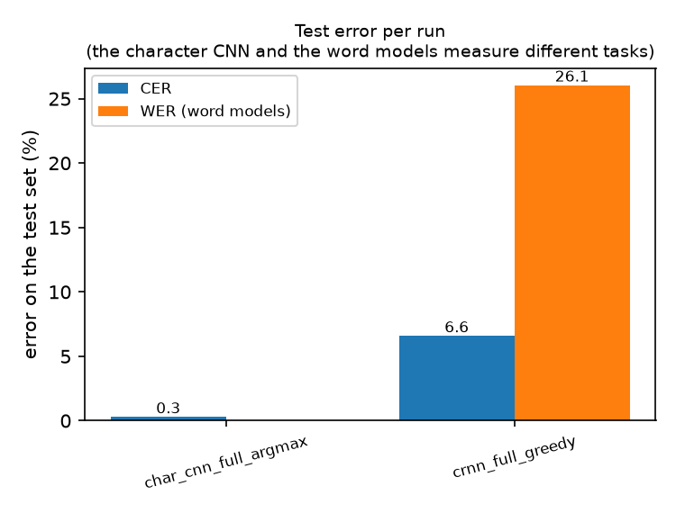
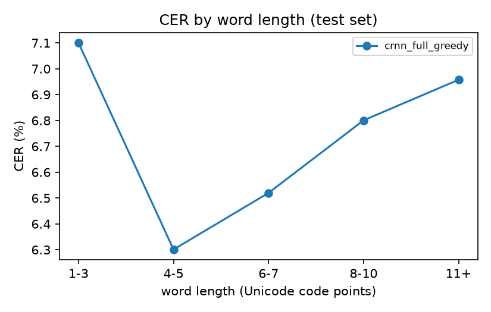

# 7. Results and analysis

## 7.1 Main comparison

All models are evaluated on their own test set, once, with the shared metric code. CER is the edit distance over Unicode code points divided by the number of reference characters; WER is the share of words that are not exactly right.

| Model | Test data | Level | Decoding | CER ↓ | WER ↓ | Accuracy ↑ | Parameters | Train time |
|---|---|---|---|---|---|---|---|---|
| A: CNN | DHCD (13,800 characters) | Character | argmax | 0.30 % | n/a | 99.72 % | 1.18 M | 1.5 min |
| B: CRNN-CTC | IIIT-HW-Dev (12,869 words) | Word | greedy | 6.59 % | 26.05 % | 73.95 % | 7.71 M | 82.1 min |
| C: TrOCR-style | IIIT-HW-Dev (12,869 words) | Word | greedy | 6.47 % | 22.32 % | 77.68 % | 28.86 M | 89.7 min |

Table: Main comparison of the three models on their test sets.

For Model B the train time is the time to the best epoch (epoch 22 of 25; the whole run took 93.3 min). For Model A, accuracy is the main metric, and its CER is computed over Unicode code points, so it is not exactly 1 − accuracy (क्ष, त्र and ज्ञ have three code points each).

*Figure: test CER and WER of the three models (`results/summary/results_chart.png`).*

## 7.2 Why the character and word error rates are not directly comparable

The CNN is tested on **isolated consonants and digits** with no vowels, no vowel signs and no context. The word models are tested on **whole words** that contain vowel signs and conjuncts, and they must also find where each character is. A character error of X % for the CNN and a CER of Y % for a word model are therefore different kinds of numbers. The gap between them mostly reflects how much harder word recognition is than classifying a clean isolated character, not a ranking of the architectures. The fair comparison is between Models B and C, which use the same data and the same metrics.

## 7.3 CRNN against TrOCR-style

At character level the two word models are equal: CER 6.47 % for TrOCR against 6.59 % for the CRNN, a difference of 0.12 points. At word level TrOCR is better: WER 22.32 % against 26.05 %, so 2,873 test words are wrong against 3,353 (480 fewer). The two models do not fail on the same words: 1,827 words are wrong for both, 1,526 only for the CRNN and 1,046 only for TrOCR.

TrOCR pays for this. It has 28.9 M parameters against 7.7 M (3.7 times more), trained for about 90 min against 82 min, and needs 70.6 ms per image against 3.6 ms (about 20 times slower). Both models were trained on all 69,853 training words, but under different budgets: the CRNN for 25 epochs and TrOCR for 5, and TrOCR's validation CER was still falling at its last epoch (Section 6.4). Each result is a single run with one seed, so the 0.12-point CER difference is within what a different seed could change; we only claim that TrOCR is slightly better at word level.

For context, the CNN-RNN baseline of the dataset's authors, trained only on IIIT-HW-Dev, reported 17.56 % CER and 45.72 % WER, and 8.64 % CER and 26.22 % WER after pre-training on synthetic Devanagari and English handwriting [3]. Both of our word models are below these numbers without synthetic data, but the numbers are not directly comparable: that work used the original release of the dataset, before its segmentation errors were corrected [3].

## 7.4 Word frequency

Every test word occurs in the training split and the test writers are new, so the test measures generalisation to new writers, not to new words (Section 3.5). To see whether rarer words are harder, we group the test images by how often their word occurs in the training split. Every test word occurs between 5 and 18 times in training, so the groups are narrow and the usual "rare word" case (1 to 4 occurrences) does not exist in this split.

| Occurrences of the word in training | Share of test images | CER B: CRNN-CTC | CER C: TrOCR-style |
|---|---|---|---|
| 5 to 6 | 33.47 % | 6.41 % | 6.49 % |
| 7 to 9 | 65.56 % | 6.70 % | 6.48 % |
| 10 or more | 0.97 % (125 images) | 5.02 % | 4.73 % |

Table: Test CER of the word models grouped by how often the word occurs in training (source: `python report/tools/word_frequency.py`, which uses the shared metric code).

The CER differs by less than 2 points across the groups and has no clear trend; the lowest value is in the 125-image group, which is too small to draw conclusions from.

## 7.5 Error analysis

Counts below are character errors (substitutions, deletions and insertions) on the test split, aligned with the same edit distance as the CER. The full tables are in `results/summary/error_analysis.md`.

**Most confused characters (Model A).** The CNN makes few errors (39 of 13,800 images). The most frequent are द → ढ and ध → घ (4 images each), and ढ → द and त्र → ब (3 each); these are pairs with similar shapes.

**Most confused characters (word models).**

| Rank | CRNN: true → predicted (count) | TrOCR: true → predicted (count) |
|---|---|---|
| 1 | त → न (128) | य → स (93) |
| 2 | म → ग (67) | त → न (92) |
| 3 | ◌ू → ◌ु (60) | ध → घ (63) |
| 4 | स → र (52) | ◌ं → ◌ँ (49) |
| 5 | ध → घ (46) | ◌ू → ◌ु (49) |

Table: Most frequent character substitutions of the word models.

Both models mix up similar-looking consonants (त/न, ध/घ, म/ग) and the long and short vowel signs ◌ू and ◌ु. TrOCR also confuses anusvara and chandrabindu, ◌ं → ◌ँ, 49 times against 31 for the CRNN.

**Kinds of errors.** Errors per true character of each type, counting insertions against the character type that was inserted:

| Character type | Share of test characters | CRNN error rate | TrOCR error rate |
|---|---|---|---|
| Consonant | 56.39 % | 6.07 % | 5.99 % |
| Vowel sign (matra) | 27.25 % | 4.94 % | 3.91 % |
| Halant (conjuncts) | 6.41 % | 11.52 % | 14.29 % |
| Anusvara / chandrabindu / visarga | 4.00 % | 10.33 % | 9.88 % |

Table: Error rate of the word models per type of true character.

Conjunct handling is the hardest for both models (the halant is wrong 11.5 % and 14.3 % of the time), and TrOCR is worse here than the CRNN, mainly because it inserts a halant that is not in the word (467 insertions against 273). Vowel signs are easier for TrOCR (3.91 % against 4.94 %), which fits the idea that a decoder that sees the neighbouring characters helps with signs whose form depends on the base letter, although we did not test this directly. The most frequent error is the plain consonant substitution; consonants make up about half of all errors for both models (51.9 % and 52.3 %).

**Word length.**

| Length (code points) | Test words | CRNN CER | TrOCR CER |
|---|---|---|---|
| 1 to 3 | 1,218 | 7.10 % | 7.60 % |
| 4 to 5 | 4,911 | 6.30 % | 6.09 % |
| 6 to 7 | 3,924 | 6.52 % | 6.18 % |
| 8 to 10 | 2,292 | 6.80 % | 6.47 % |
| 11 or more | 524 | 6.96 % | 8.29 % |

Table: Test CER of the word models by word length.

*Figure: test CER of the word models by word length (`results/summary/cer_by_length.png`).*

The CRNN's CER is almost flat across lengths (6.30 to 7.10 %). TrOCR is better than the CRNN for words of 4 to 10 characters, but worse for the shortest words (1 to 3) and for the longest (11 or more, 8.29 %). The longest words are the ones most distorted when resized to a square input (Section 6.5), which may be one reason, but we did not test it.

**Examples.** Three failure cases from the test split show the typical errors: पत्ते is read as पन्ने by the CRNN and पत्ने by TrOCR (त read as न, the most frequent confusion); नंबर is read as नबर by both (the anusvara is dropped); and रिवाज़ is read as रिवाज by both (the nukta is dropped). Small marks (anusvara, nukta, danda) are the ones most often missing in both models; the nukta and the punctuation together account for 5.3 % (CRNN) and 5.9 % (TrOCR) of all errors.

## 7.6 Low-resource discussion

With only 7 training writers and a closed vocabulary, the main difficulty is the handwriting of new writers. Here a model pre-trained on English handwriting (Model C) matched the CER of the CRNN trained from scratch and had a 3.7-point lower WER; without a from-scratch TrOCR run we cannot say how much of this is due to pre-training.
